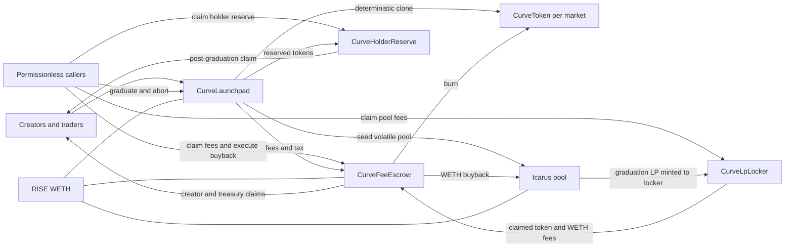
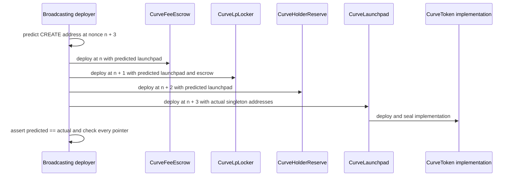
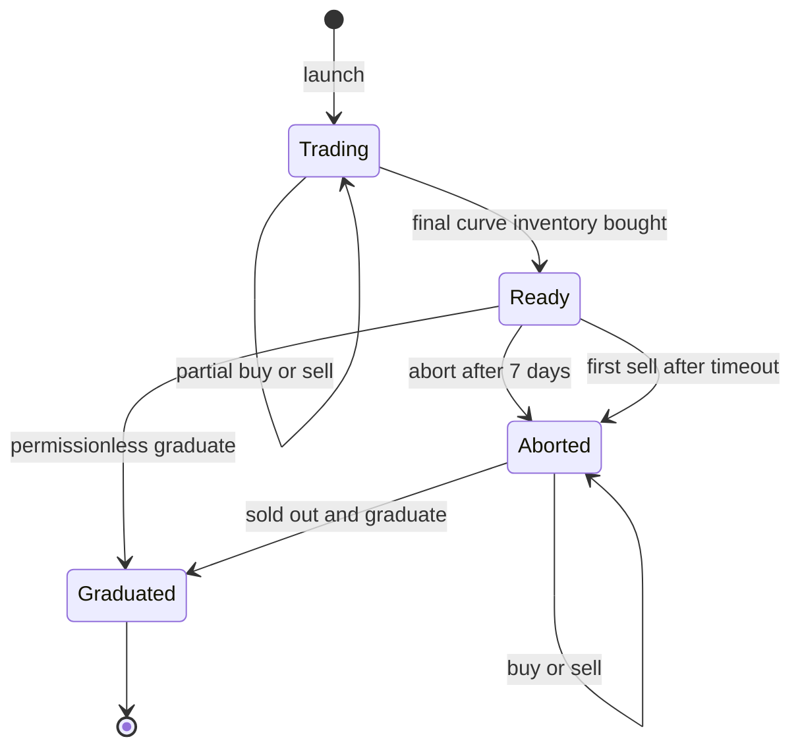

# Architecture

## System purpose

Curveball launches fixed-supply ERC-20 tokens on isolated virtual-reserve bonding curves. Each market sells at most 80% of its supply, optionally reserves up to 4% for curve holders, uses part of the remaining inventory to seed and permanently lock liquidity in an external Icarus volatile pool, and burns the rest. Trading fees are split among the creator, protocol treasury, and token buybacks.

The protocol has no proxy or upgrade mechanism. It consists of four directly deployed singleton modules, one immutable token implementation cloned per market, a pure math library, and two external integration seams.



## Modules and state ownership

| Module | Interface and responsibility | State owned by the implementation |
| --- | --- | --- |
| `CurveLaunchpad` | Launch, buy, sell, abort, graduate, previews, bounded administration | Every `Market`, per-creator launch nonce, historical `held` ledger, defaults, target, pause state, and aggregate curve liabilities |
| `CurveToken` | Fixed-supply market ERC-20 with a pre-graduation transfer lock | Clone balances, allowances, total supply, permit nonces, metadata, initialization flag, and permanent unlock flag; launchpad authorization is immutable in implementation bytecode |
| `CurveFeeEscrow` | Backed fee accounting, pull claims, bounded permissionless buybacks, surplus rescue | Claimable balances, per-market buyback credit and timestamp, per-asset aggregate liabilities |
| `CurveLpLocker` | Permanent LP custody and permissionless fee forwarding | Registered pool-to-market mapping; it has no LP withdrawal interface |
| `CurveHolderReserve` | Post-graduation pro-rata distribution of reserved tokens | Registered reserve amounts and per-account one-time claim flags |
| `CurveMath` | Curve quotations, target initialization, pool-seed calculation, and fee splitting | No state |
| Icarus seam | Factory discovery/creation, pool reserves, liquidity minting, swaps, observations, and fee claims | External factory and pool state |
| Quote-token seam | Curve reserve, fee asset, pool quote asset, and buyback input | External ERC-20 state; configured as RISE WETH |

`CurveLaunchpad` is the coordinating deep module: callers use a compact lifecycle interface while token deployment, reserve accounting, fee routing, custody, state transitions, and pool graduation stay local to its implementation.

Cross-module interfaces are intentionally narrow:

- `ICurveLaunchpad` exposes only the treasury, locker, curve supply, snapshotted fee policy, graduated pool, and historical holdings needed by the other singletons.
- `ICurveSingletons` exposes only fee distribution and pool/reserve registration.
- `IIcarusFactory` and `IIcarusPool` describe only the external behavior Curveball invokes.

## Immutable topology and deployment order

The escrow, locker, and reserve require the launchpad address in their constructors, but the launchpad must receive their deployed addresses. `CurveDeploy` resolves this cycle by predicting the launchpad address from the deployer's nonce.



Any nonce shift causes the deployment to revert with `AddressPredictionMismatch`; every immutable cross-reference and authority is checked after construction. The launchpad constructor's internal creation of the token implementation occurs after the launchpad address is fixed and does not consume the external deployer's nonce.

## Market lifecycle



State meanings:

- `None`: no market exists for the token address.
- `Trading`: buys and sells are open.
- `Ready`: all 800,000 curve tokens are sold; trading is closed and graduation is immediately available.
- `Aborted`: a `Ready` market remained ungraduated for seven days. Sells reopen permanently, buys work whenever inventory is available, and graduation remains possible whenever the curve sells out again.
- `Graduated`: curve accounting is closed, token transfers are unlocked, liquidity is seeded, LP is locked, and holder-reserve claims are enabled.

`Aborted` is deliberately sticky. Re-selling out emits `GraduationReady` but does not return the market to `Ready`, so holders never lose their reopened sell path.

The launchpad pause is orthogonal to market state. It stops only new launches and buys. Sells, aborts, graduation, LP fee collection, fee claims, reserve claims, and buybacks remain available.

## Asset and accounting domains

Curveball keeps four distinct accounting domains:

1. **Curve inventory and quote liability** — the launchpad holds unsold market tokens and WETH backing each market's `realQuote`. `totalRealQuote` aggregates all ungraduated market liabilities.
2. **Fee liabilities** — the escrow holds creator claims, treasury claims, and quote-token buyback credit. `totalOwed[quoteToken]` includes pull claims and every market's buyback credit; for market-token fees, the buyback share burns immediately and never becomes a liability.
3. **LP principal** — the locker receives the LP minted by Curveball's graduation except Icarus's protocol-level minimum-liquidity lock. No Curveball function can move that LP; this does not prevent unrelated parties from adding later pool liquidity.
4. **Holder reserve** — the reserve contract receives its allocation at token initialization and pays it only after graduation from the frozen `held` ledger.

These domains do not share rescue capacity. Launchpad rescue is limited by `totalRealQuote`; escrow rescue is limited by `totalOwed`; locker LP and holder-reserve balances have no administrative rescue path.

## End-to-end flows

### Launch

1. The creator supplies metadata, creator tax, reserve share, and an optional first-buy budget.
2. The launchpad validates URI length, tax, and reserve bounds, then deploys a deterministic EIP-1167 clone using `keccak256(abi.encode(creator, launchNonce))`.
3. The launch fee transfers directly to the treasury.
4. The token initializes once and mints the reserve allocation to `CurveHolderReserve` and all remaining supply to the launchpad.
5. A nonzero reserve is registered only after the reserve contract verifies backing.
6. The market's creator, fee policy, tax, initial virtual reserves, and reserve allocation are snapshotted.
7. An optional first buy follows the same path as every later buy and delivers tokens only to the payer.

The URI is emitted in `LaunchCreated` but is not stored on-chain.

### Curve buy

1. `CurveMath` removes fee and tax from the caller's maximum total spend and computes output from the virtual constant product.
2. The launchpad decreases virtual-token reserves, increases virtual and real quote, increases `totalRealQuote`, and credits the caller's `held` ledger.
3. Curve quote transfers from the buyer to the launchpad.
4. Fee and tax transfer directly from the buyer to the escrow before `distribute` records liabilities.
5. Market tokens transfer from the launchpad only to the buyer.

There is no recipient parameter. Together with the token lock, this prevents a buyer from routing curve tokens into the future pool before graduation. Approvals and permits may exist before graduation, but they cannot move tokens between other addresses or enable holder burns.

### Curve sell

1. A timed-out `Ready` market first becomes `Aborted` inline.
2. `CurveMath` computes gross curve quote, fee, tax, and net output.
3. The seller's `held` balance, market `realQuote`, and global `totalRealQuote` decrease by the gross amount.
4. Tokens return to the launchpad, net WETH goes to the seller, and retained fee/tax goes to the escrow.

### Graduation

1. The launchpad accepts `Ready`, or `Aborted` only when exactly sold out.
2. It marks the market `Graduated`, clears its curve liability, and permanently unlocks the token.
3. It obtains or creates the canonical volatile Icarus pool. An existing pool must have zero LP supply.
4. It skims unsynced balances back to the launchpad and rejects any synced market-token reserve.
5. Curve WETH plus any synced WETH reserve is paired with tokens at the closing curve price, subject to the available non-curve inventory and token balance.
6. LP is minted directly to the locker, then exact post-mint token and quote reserves are verified.
7. Every market token left at the launchpad is burned and the pool is registered with the locker.

Quote-side donation size cannot make graduation revert: synced WETH is matched while burn-buffer inventory exists, then the token input clamps and the donor receives a worse opening price. This guarantee does not apply to a pool already containing LP or synced market tokens; both are intentionally rejected as `PoolUsed`.

### LP fees and escrow

Anyone can trigger `CurveLpLocker.claim` for a registered pool. The locker attributes only the amounts returned by Icarus `claimFees`, transfers those assets to the escrow, and then calls `distribute`. Stray balances are not assigned to a market.

For quote-token fees, the buyback share becomes `buybackBalance[token]` and is included alongside pull claims in `totalOwed[quoteToken]`. For market-token fees, that share is burned immediately and excluded from liabilities; creator and treasury shares remain pull-based claims.

The locker does not independently validate the pool's two asset addresses. Safety relies on registration being launchpad-only and following canonical factory lookup/creation and verified seeding.

### Buyback

Anyone can trigger a buyback after graduation. The escrow synchronizes the pool, requires sufficient TWAP history, checks factory pause, compares current fee-adjusted spot output against a fee-adjusted two-window TWAP, spends a bounded quote amount, and burns the token balance actually received. Environmental non-readiness returns zero without consuming the interval; misuse such as calling too soon reverts.

### Holder reserve

After graduation, each address may claim once:

```text
floor(reserveOf[token] × held[token][account] / CURVE_SUPPLY)
```

The `held` ledger tracks only net curve purchases and sales. It freezes after graduation, so later ERC-20 transfers neither move nor change reserve entitlements. Round-down dust and unclaimed or never-graduated allocations remain in the reserve by design.

## Roles and authority

| Role | Powers | Explicit limitations |
| --- | --- | --- |
| Owner | Update defaults for future markets, update future graduation target, rotate guardian, unpause, rescue provable surplus; escrow owner can rescue escrow surplus | Two-step ownership; cannot renounce; target must meet minimum, exact-divisibility, and `uint128` bounds; cannot change snapshotted markets, immutable addresses, LP custody, or reserve entitlements |
| Guardian | Pause launches and buys | Cannot unpause, seize assets, modify policy, block sells, or block graduation |
| Treasury | Receives launch fee and protocol fee share | Immutable recipient, no special callable authority |
| Creator | Chooses metadata, tax within current cap, reserve within maximum, and optional first buy | Fee policy and tax are fixed for that market after launch |
| Trader | Buy and sell subject to state, pause, deadline, balance, and slippage | Pre-graduation transfers cannot bypass the curve |
| Public caller | Graduate, abort after timeout, claim LP fees, execute buybacks, and claim own balances | Cannot redirect another account's claim or move locked LP |
| Icarus pauser | Pauses Icarus swaps | Under the integrated Icarus implementation, pause affects swaps only and does not block graduation; paused swaps make buyback skip |

Mainnet deployment gives launchpad and escrow the same initial owner and requires it to be a timelock contract with a nonzero delay and a contract proposer holding `PROPOSER_ROLE`; guardian and treasury must also be contracts. The two ownership roles can later be transferred independently. These checks validate interfaces and live state, not implementation bytecode hashes.

All value-moving launchpad entry points and all escrow mutation/transfer entry points use `nonReentrant`. The ownerless locker and reserve instead rely on narrow registration authority, fixed trusted adapters, and state/backing checks before onward transfers.

## Upgradeability and immutability

- No Curveball contract is proxied or upgradeable.
- Singleton addresses and the quote token/factory references are immutable.
- Market tokens are deterministic clones of the immutable implementation created by the launchpad constructor.
- Each market snapshots economic policy at launch; later owner changes apply only to new markets.
- The treasury and launch fee are immutable launchpad values.
- The locker and reserve have no owner.
- Ownership renunciation is disabled on both owned modules.

## Source map

| Topic | Primary source |
| --- | --- |
| Market lifecycle and accounting | `contracts/CurveLaunchpad.sol` |
| Curve formulas and fee splitting | `contracts/libraries/CurveMath.sol` |
| Token clone and transfer lock | `contracts/CurveToken.sol` |
| Claims and buybacks | `contracts/CurveFeeEscrow.sol` |
| LP custody and pool fee routing | `contracts/CurveLpLocker.sol` |
| Holder reserve claims | `contracts/CurveHolderReserve.sol` |
| External integration surface | `contracts/interfaces/IIcarus.sol` |
| Immutable deployment wiring | `scripts/CurveDeploy.sol` |
| Network policy and preflight | `scripts/Deploy.s.sol` |
