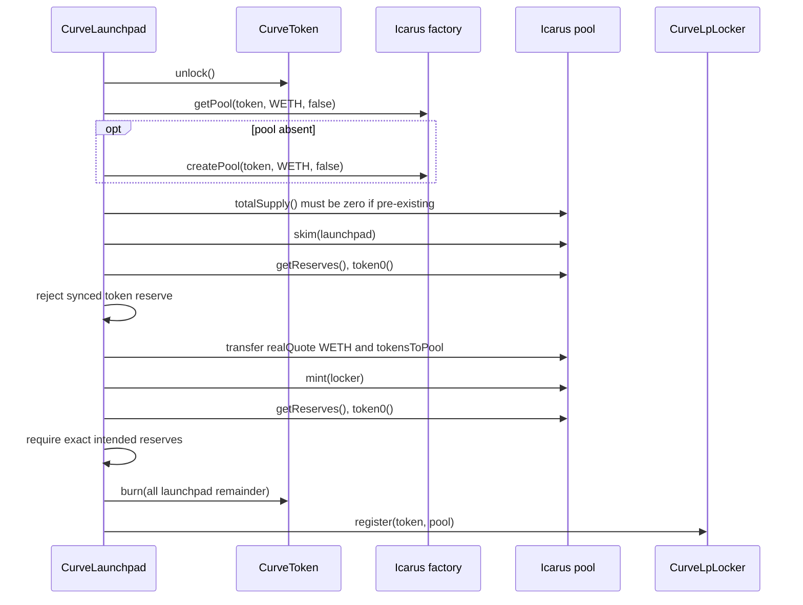
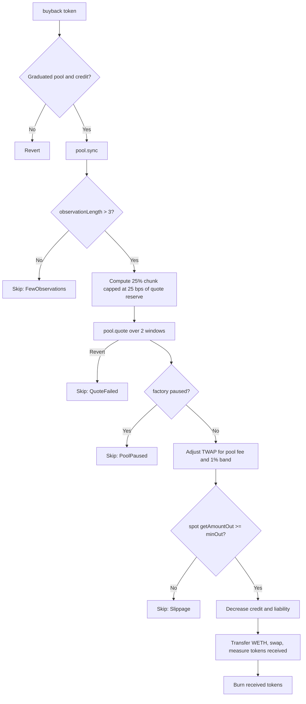

# Integration and deployment specification

Curveball has two production integration seams: the configured quote token (RISE WETH) and the configured Icarus factory/pools. Their implementations are external to this repository. This document separates behavior enforced by Curveball from behavior assumed of those dependencies.

## Supported networks and addresses

| Network | Chain ID | WETH | Icarus factory | Fork block |
| --- | ---: | --- | --- | ---: |
| RISE mainnet | 4153 | `0x4200000000000000000000000000000000000006` | `0xEe10C6a0f158bFEeef3d48Dc0D26130Cf6115615` | 24,722,082 |
| RISE testnet | 11155931 | `0x4200000000000000000000000000000000000006` | `0x8221dfB70c9A2dE60253dcfC58231FD529bbF4F9` | 57,239,173 |

The fork blocks are test fixtures, not deployment blocks. Actual Curveball deployment addresses and mainnet authority addresses are not included in this snapshot.

## Icarus factory interface

Curveball calls:

| Function | Curveball use | Required semantics |
| --- | --- | --- |
| `isPaused()` | Deployment preflight and buyback | Returns global swap-pause state |
| `getPool(tokenA, tokenB, false)` | Graduation | Symmetric lookup of the canonical volatile token pair |
| `createPool(tokenA, tokenB, false)` | Graduation | Creates and returns that canonical volatile pair |
| `getFee(pool, false)` | Buyback | Returns current volatile swap fee in basis points |
| `getUnstakedFee(pool)` | Not called by production Curveball | Present in the narrow interface for integration compatibility and mocks |

Curveball always requests `stable = false`.

The factory is trusted to return the correct token/WETH pair. Curveball does not independently require that the returned pool's two tokens equal the requested pair. Reserve mapping, LP fee attribution, and buyback orientation therefore rely on canonical factory behavior.

The fee is assumed to be at most 10,000 bps. Curveball does not independently bound the value returned by `getFee`; a larger value makes checked buyback arithmetic revert.

## Icarus pool interface

| Function | Required semantics |
| --- | --- |
| `token0()`, `token1()` | Consistent token ordering; reserves and fee-return tuples follow this orientation |
| `totalSupply()` | Nonzero means the pool has already been initialized and must not be used for graduation |
| `balanceOf(account)` | Standard LP balance view |
| `getReserves()` | Returns reserves corresponding exactly to `token0` and `token1` |
| `mint(to)` | Consumes deposited balances, updates reserves, and mints LP to `to` |
| `skim(to)` | Transfers balances above recorded reserves to `to` without changing reserves |
| `sync()` | Folds live balances into reserves and updates cumulative/observation state |
| `swap(amount0Out, amount1Out, to, data)` | Pays the requested output after input was transferred; obeys factory swap pause |
| `claimFees()` | Transfers the caller's LP fee entitlement and returns exact token0/token1 amounts transferred |
| `getAmountOut(amountIn, tokenIn)` | Current-reserve, post-pool-fee output |
| `quote(tokenIn, amountIn, granularity)` | Fee-free TWAP output over the requested observation windows |
| `observationLength()` | Number of available TWAP observations |

Additional assumptions exercised by the mock and fork suites:

- Tokens are sorted consistently into token0/token1.
- The volatile pool has a 1,000-LP-base-unit minimum-liquidity lock on first mint.
- Only swaps are assumed to be blocked by the factory pause; `mint`, `skim`, `sync`, observation reads, and fee claims remain usable. Live forks directly exercise paused graduation and buyback skipping, but do not separately claim LP fees while paused.
- Observations advance in 30-minute windows.
- `quote` may underflow or revert when insufficient observation history exists.
- LP fees are separated from an unstaked/gauge share; `claimFees` pays the LP share only.
- Pool fee and unstaked fee values use basis points.

The mock creates pools deterministically with CREATE2, but production Curveball neither predicts nor depends on the pool address. It relies solely on `getPool` and `createPool`.

## Pool orientation

All production paths support either ordering:

- Graduation maps `getReserves()` according to whether `token0 == marketToken`.
- Buyback derives the quote reserve and selects `amount0Out` or `amount1Out` from the same comparison.
- LP fee collection maps the two amounts returned by `claimFees` and treats the pool's other token as quote.

Orientation correctness still depends on the factory returning a pool containing exactly the market token and WETH.

## Graduation integration protocol

Graduation calls external modules in this order:



The market is marked graduated and its quote liability is cleared before external calls, but EVM atomicity rolls all of that back if any integration call fails.

### Pool contamination and donations

| Pool condition before graduation | Result |
| --- | --- |
| No pool exists | Create volatile pool and seed it |
| Pool exists, no LP, no balances | Reuse and seed it |
| Unsynced WETH donation | `skim` returns it to launchpad; it becomes launchpad surplus |
| Unsynced market-token balance | `skim` returns it to launchpad and excess is burned; ordinary holders cannot create this before graduation because the token lock blocks holder-to-pool transfers |
| Synced WETH reserve | Included in `quoteInPool` and matched at closing curve price while token buffer permits |
| Synced WETH exceeds matchable buffer | Token input clamps; the pool opens at a higher quote-per-token price and donated excess is not recovered through graduation |
| Synced market-token reserve | Revert `PoolUsed` |
| Nonzero LP supply | Revert `PoolUsed` |
| Post-mint reserves differ from exact intended seed | Revert `MintMismatch` |

The donation-resistance design is specifically quote-side: within WETH supply/arithmetic bounds and expected Icarus mint semantics, WETH donation alone should not wedge graduation. Token-side synced contamination and previously initialized pools are intentionally rejected.

The return value of `pool.mint` is ignored. Exact post-mint reserves are checked, while the production graduation function does not independently assert a nonzero LP return or query the locker LP balance. The fork suite verifies expected Icarus mint behavior.

## LP fee integration protocol

The pool mints Curveball's LP position directly to `CurveLpLocker`. The locker has no owner, transfer, withdrawal, or rescue function.

Anyone may invoke `claim(pool)`:

1. Require pool registration.
2. Call Icarus `claimFees()`.
3. Interpret returned token0/token1 amounts by orientation.
4. Transfer each nonzero returned amount to escrow.
5. Call `distribute` only after the transferred asset backs the new liability.

Under the required honest `claimFees` semantics, using returned amounts rather than locker balance differences prevents unrelated token transfers from being attributed to a market. Exact return/transfer correspondence is a trusted pool assumption: an under-transfer normally makes the subsequent safe transfer revert, but existing stray locker balance could cover a shortfall from a dishonest return and be misattributed.

## Buyback integration protocol



Pause is checked before WETH transfer so the expected paused condition returns a clean skip without touching balances or relying on swap rollback. Successful accounting updates precede the transfer/swap, but unexpected downstream failure reverts them atomically.

Only the TWAP `quote` call is caught. A revert from `sync`, orientation or reserve reads, factory fee reads, `getAmountOut`, token transfer, or `swap` reverts the buyback transaction. The four documented environmental skip paths preserve the buyback balance and do not update `lastBuyback`.

## WETH and ERC-20 requirements

Production treats WETH only as an ERC-20; it never unwraps native ETH. Fork tests call `deposit()` solely to fund test actors.

Required quote-token behavior:

- 18 decimals, matching parameters expressed in `ether` units.
- Standard `balanceOf`, `transfer`, and `transferFrom` behavior compatible with `SafeERC20`.
- No transfer fee, rebasing, or hooks that change received amounts.
- No unexpected callback/reentrancy behavior.

Exact curve liabilities and exact pool reserve checks make fee-on-transfer or rebasing quote tokens unsupported. Deployment checks that WETH has code but does not verify name, symbol, decimals, bytecode hash, or implementation.

Launched tokens use Solady ERC-20 behavior with 18 decimals, clone-specific permit domains, disabled automatic Permit2 infinite allowance, and the Curveball transfer lock described in the protocol specification. Icarus pool creation is assumed compatible with both assets' ERC-20 metadata calls, including `symbol()` and `decimals()`; CurveToken satisfies these calls, while deployment does not independently validate WETH metadata.

## Deployment parameters

Shared parameters encoded by `Deploy`:

| Parameter | Value |
| --- | --- |
| Quote token | RISE WETH above |
| Launch fee | 0.001 WETH |
| Curve fee | 75 bps |
| Creator fee share | 5,000 bps |
| Buyback fee share | 2,500 bps |
| Creator-tax cap | 50 bps |

Testnet additionally fixes:

- graduation target: 0.01 WETH;
- owner, guardian, and treasury: `0xd07988eCBCf446b9650dC93Ed9c61Bf97F02a8d3`.

Mainnet reads:

- `CURVE_OWNER`;
- `CURVE_GUARDIAN`;
- `CURVE_TREASURY`;
- `CURVE_TIMELOCK_PROPOSER`;
- `CURVE_GRADUATION_TARGET`.

Unsupported chain IDs revert.

## Deployment wiring

The broadcasting account and nonce form part of the deployment interface. `CurveDeploy` predicts the fourth CREATE address and deploys in this exact order:

1. `CurveFeeEscrow(predictedLaunchpad, quoteToken, icarusFactory, owner)`
2. `CurveLpLocker(predictedLaunchpad, escrow)`
3. `CurveHolderReserve(predictedLaunchpad)`
4. `CurveLaunchpad(fullConfig)`

The fourth address must equal the prediction. After deployment, `_checkWiring` validates:

- escrow launchpad, quote token, Icarus factory, and owner;
- locker launchpad and escrow;
- reserve launchpad;
- launchpad escrow, locker, reserve, quote token, Icarus factory, treasury, owner, and guardian.

`Deploy.run` constructs parameters and completes all preflight calls before `vm.startBroadcast`. It then uses the actual broadcasting caller from `vm.readCallers()` for nonce prediction. Retrying with a changed nonce must re-simulate; a mismatch reverts instead of leaving immutable modules miswired.

## Deployment preflight

All supported networks require:

- WETH has code;
- Icarus factory has code;
- Icarus is not paused at deployment time;
- graduation target is at least 0.01 WETH.

Mainnet additionally requires:

- owner is a contract;
- owner responds to `getMinDelay()` with a nonzero delay;
- proposer is a contract;
- owner reports proposer has `keccak256("PROPOSER_ROLE")`;
- guardian is a contract;
- treasury is a contract.

These are interface/state checks, not bytecode-hash attestations. `ITimelock` is duck-typed through `getMinDelay` and `hasRole`. Constructor validation independently checks immutable addresses, launch fee, economic bounds, and target arithmetic.

## Fork verification

The fork harness fails closed under `CI_FORK=1`, asserts the RPC's chain ID, and uses the pinned blocks above unless `FORK_BLOCK` overrides them.

```sh
RISE_MAINNET_RPC_URL=<url> make test-fork-strict
RISE_TESTNET_RPC_URL=<url> make test-fork-testnet
```

The lifecycle forks verify against live Icarus and WETH state:

- canonical volatile pool discovery;
- pool seed at closing curve price;
- the 1,000-LP-base-unit Icarus minimum-liquidity lock;
- remaining LP held by CurveLpLocker;
- 30-minute observation behavior and usable TWAP history;
- LP fee claims excluding the unstaked/gauge share;
- fee routing and escrow backing;
- Icarus pause skips buyback without consuming its interval;
- successful buyback and burn;
- synced WETH donation handling;
- graduation while Icarus swaps are paused.

Deployment forks verify the complete testnet parameters/wiring and mainnet rejection of an EOA owner.

At preparation time, the sanitized snapshot passed 4/4 mainnet fork tests and 4/4 testnet fork tests. This evidence applies to the pinned states and configured addresses; it is not a bytecode immutability guarantee for external contracts.

The factory address is immutable inside Curveball, but any external administrator or upgrade mechanism controlling Icarus remains trusted. Post-deployment changes to pause state, fees, pool creation, canonical-pair behavior, pool implementation, observations, or fee claims can affect graduation and buyback safety/liveness. Curveball's deployment preflight checks only current code presence and pause state.

## Integration trust and failure matrix

| Assumption or failure | Curveball response |
| --- | --- |
| Wrong factory/pool bytecode with matching interface | Not detected by deployment; trusted dependency risk |
| Factory returns wrong token pair | Not independently detected; may misattribute reserves/fees |
| Icarus paused at deployment | Preflight reverts |
| Icarus paused during graduation | Graduation proceeds; mint/skim are assumed usable |
| Icarus paused during buyback | Emits skip before transfer; interval not consumed |
| Insufficient TWAP observations | Buyback skip |
| TWAP `quote` reverts | Buyback skip |
| Spot price outside fee-adjusted TWAP band | Buyback skip |
| Other unexpected Icarus call reverts | Calling transaction reverts atomically |
| Existing initialized pool | Graduation reverts `PoolUsed` |
| Synced token contamination | Graduation reverts `PoolUsed` |
| Post-mint reserve mismatch | Graduation reverts `MintMismatch` |
| WETH transfer charges a fee or rebases | Unsupported; accounting/checks may revert or become invalid |
| Timelock-compatible malicious contract | Interface preflight can pass; implementation is not attested |
